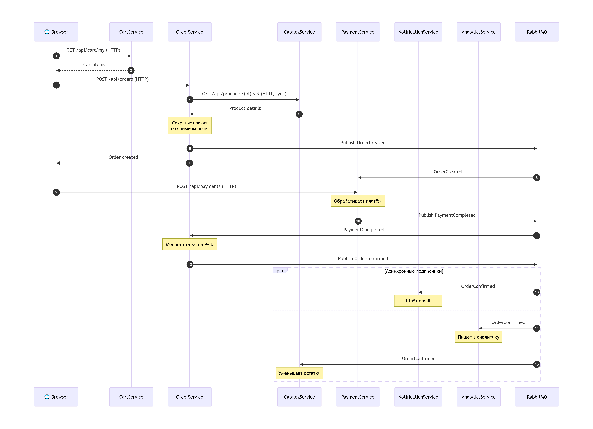
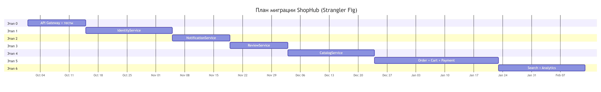

# ShopHub — Документ декомпозиции монолита (КТ-2)

**Версия:** 1.0
**Дата:** 17.09.2026
**Проект:** ShopHub — интернет-магазин на ASP.NET Core MVC
**Задача:** декомпозиция монолита на микросервисы

---

## Оглавление

1. [Анализ монолита](#1-анализ-монолита)
2. [Context Map](#2-context-map)
3. [Список сервисов](#3-список-сервисов)
4. [Распределение данных](#4-распределение-данных)
5. [Схема коммуникаций](#5-схема-коммуникаций)
6. [План миграции](#6-план-миграции)
7. [Риски и ограничения](#7-риски-и-ограничения)
8. [Технологический стек](#8-технологический-стек)
9. [Заключение](#9-заключение)

---

## 1. Анализ монолита

Монолит ShopHub написан на ASP.NET Core MVC, использует один `DbContext` и одну базу данных. При росте команды до 8 человек проявились проблемы: единый деплой, конфликты в git, невозможность масштабировать отдельные части, падение всего приложения из-за одного бага.

Ниже — список бизнес-функций, выявленных при анализе контроллеров и сервисов.

### 1.1 Управление пользователями (Identity and Access)

**Что делает:** регистрация, вход, выход, управление профилем (имя, телефон, адрес), роли (покупатель/администратор), проверка токенов.

**Файлы:** `AccountController.cs`, `UserService.cs`, таблица `Users`.

**Почему отдельная функция:** это фундамент безопасности. Все остальные функции зависят от того, кто выполняет действие и что ему разрешено. Аутентификация и авторизация — сквозной концерн, который меняется по своим правилам (пароли, токены, роли) и не должен быть связан с бизнес-логикой каталога или заказов.

### 1.2 Каталог товаров

**Что делает:** управление товарами и категориями (CRUD для администратора), отображение каталога, карточек товаров, остатков, изображений.

**Файлы:** `ProductController.cs`, `ProductService.cs`, часть `AdminController.cs`, таблицы `Products`, `Categories`.

**Почему отдельная функция:** независимая область бизнеса с собственным жизненным циклом. Нагрузка на чтение каталога в разы выше, чем на запись, и её нужно масштабировать отдельно.

### 1.3 Корзина

**Что делает:** хранение корзины пользователя, добавление, удаление и изменение количества товаров, подсчёт суммы.

**Файлы:** `CartController.cs`, `CartService.cs`, таблицы `Carts`, `CartItems`.

**Почему отдельная функция:** корзина — временное состояние, привязанное к пользователю. Она не является заказом: заказ — это обязательство, корзина — намерение. У неё другие требования к консистентности и сроку жизни данных.

### 1.4 Заказы

**Что делает:** оформление заказа из корзины, хранение истории заказов, смена статусов (создан, оплачен, отправлен, завершён), хранение адреса доставки.

**Файлы:** `OrderController.cs`, `OrderService.cs`, таблицы `Orders`, `OrderItems`.

**Почему отдельная функция:** заказ — это юридический и финансовый факт. Он должен хранить снимок товара на момент покупки (название, цену), чтобы история не менялась при обновлении каталога.

### 1.5 Платежи

**Что делает:** приём оплаты через двух провайдеров, обработка статусов платежа, возвраты, интеграция с внешними API.

**Файлы:** `PaymentController.cs`, `PaymentService.cs`, таблица `Payments`.

**Почему отдельная функция:** финансы — зона с максимальными требованиями к надёжности (99.99% uptime) и безопасности. Она не должна падать вместе с отзывами или каталогом. Здесь своя модель данных.

### 1.6 Уведомления

**Что делает:** отправка email и SMS — подтверждения заказа, смена статуса, маркетинговые рассылки.

**Файлы:** `EmailService.cs`, `SmsService.cs`, таблица `Notifications`.

**Почему отдельная функция:** коммуникации с клиентом — единый бизнес-контекст. Email и SMS — два канала одной службы. Уведомления всегда асинхронны по своей природе.

### 1.7 Отзывы

**Что делает:** оставление отзывов и рейтингов на товары, модерация.

**Файлы:** `ReviewController.cs`, `ReviewService.cs`, таблица `Reviews`.

**Почему отдельная функция:** пользовательский контент, который не влияет на операционные процессы. У отзывов низкие требования к SLA, их можно отключить без катастрофы.

### 1.8 Поиск

**Что делает:** полнотекстовый поиск по каталогу (в монолите — SQL LIKE).

**Файлы:** `SearchService.cs`.

**Почему отдельная функция:** поиск — особая нагрузочная функция. Тяжёлые запросы забивают пул соединений и тормозят всю систему. Ей нужна отдельная технология (Elasticsearch) и независимое масштабирование.

### 1.9 Аналитика и отчёты

**Что делает:** отчёты по продажам, дашборды для администраторов.

**Файлы:** `ReportController.cs`, `ReportService.cs`.

**Почему отдельная функция:** аналитика читает данные из всех контекстов, но не влияет на операционные процессы. Тяжёлые отчётные запросы не должны нагружать базу данных покупателей.

---

## 2. Context Map

### 2.1 Ключевое наблюдение: одно слово — разные смыслы

Понятие «Продукт» в разных контекстах означает разное:

| Контекст | Что означает «Продукт» | Почему так |
|---|---|---|
| Каталог | Название, описание, категория, изображения, SEO-slug, остаток | Полная информация для отображения покупателю; цена может меняться |
| Заказ | Название на момент покупки, цена на момент покупки, SKU | Цена не должна меняться при обновлении каталога |
| Корзина | ID, текущая цена, доступное количество | Нужно знать наличие прямо сейчас |
| Отзывы | ID, название (ссылка на карточку) | Только идентификатор и отображаемое имя |

Понятие «Пользователь» в разных контекстах означает разное:

| Контекст | Что означает «Пользователь» | Почему так |
|---|---|---|
| Идентификация | Email, хэш пароля, роли, токен, дата последнего входа | Кто ты и что тебе можно |
| Заказы | ID, адрес доставки, история заказов | Для оформления и доставки |
| Уведомления | Email, телефон, настройки уведомлений | Контакты и предпочтения |
| Отзывы | ID, отображаемое имя | Только для подписи отзыва |

### 2.2 Схема ограниченных контекстов

### 2.3 Отношения между контекстами

| Отношение | Тип | Описание |
|---|---|---|
| Identity и остальные | Shared Kernel (UserId, Role) | Identity даёт UserId и роль всем остальным сервисам |
| Catalog к Cart | Customer/Supplier | Cart запрашивает актуальную цену и остаток |
| Cart к Order | Customer/Supplier | Order берёт содержимое корзины при оформлении |
| Order к Payment | Partnership | Тесно связаны: заказ без оплаты не имеет смысла |
| Order к Notification | Published Language | Order публикует события, Notification слушает |
| Catalog к Search | Published Language | Catalog публикует CatalogUpdated, Search обновляет индекс |
| Все к Analytics | Conformist | Analytics потребляет события всех, не влияя на них |

---

## 3. Список сервисов

| # | Сервис | Порт | Ответственность | Обоснование границ | Команда |
|---|---|---|---|---|---|
| 1 | IdentityService | 5001 | Регистрация, вход, JWT-токены, роли, профиль | Аутентификация и профиль тесно связаны, разделение создаст лишнюю связность | Безопасность |
| 2 | CatalogService | 5002 | Продукты, категории, остатки, изображения, админка каталога | Управление каталогом — часть бизнеса каталога, нет смысла выделять отдельно | Каталог |
| 3 | CartService | 5003 | Корзина пользователя, добавление и удаление товаров, пересчёт суммы | Временное состояние, отдельные требования к скорости и сроку жизни | Покупки |
| 4 | OrderService | 5004 | Создание заказов, статусы, история, снимок товара | Финансовый факт; должен хранить снимок, чтобы история не менялась | Заказы |
| 5 | PaymentService | 5005 | Обработка платежей, провайдеры, возвраты | Максимальные требования к надёжности и безопасности | Финансы |
| 6 | NotificationService | 5006 | Email, SMS, push, шаблоны, логи отправки | Email и SMS — один контекст коммуникаций; всегда асинхронны | Коммуникации |
| 7 | ReviewService | 5007 | Отзывы, рейтинги, голоса «полезно/нет» | Пользовательский контент с низкими требованиями к SLA | Контент |
| 8 | SearchService | 5008 | Полнотекстовый поиск, индексация каталога | Особая нагрузка, отдельная технология, независимый масштаб | Каталог |
| 9 | AnalyticsService | 5009 | Отчёты, дашборды, сбор событий | Тяжёлые запросы не должны нагружать операционные сервисы | Данные |

### 3.1 Что объединяется

- **EmailService и SmsService объединяются в NotificationService.** Один бизнес-контекст «Коммуникации с клиентом». Они всегда меняются вместе.
- **UserProfile и Identity объединяются в IdentityService.** Профиль и аутентификация так тесно связаны, что разделение создаст лишнюю связность.
- **CatalogService и часть AdminController объединяются.** Управление каталогом — часть бизнеса каталога.

### 3.2 Что разделяется

- **SearchService выделяется отдельно.** Особая нагрузка, особая технология (Elasticsearch), независимый масштаб.
- **AnalyticsService выделяется отдельно.** Тяжёлые отчётные запросы не должны нагружать операционные сервисы.

### 3.3 Самопроверка границ

Для каждого сервиса выполняются условия:

| Вопрос | Ответ |
|---|---|
| Можно задеплоить независимо от других | Да |
| Команда из 5-8 человек может владеть полностью | Да |
| Одна чётко формулируемая ответственность | Да |
| При падении система продолжит частично работать | Да |
| Данные принадлежат только ему | Да |

---

## 4. Распределение данных

Принцип: Database per Service. Каждый сервис владеет своей базой данных, никто не лезет в чужую.

### 4.1 Таблицы по сервисам

| Сервис | Таблицы | Тип БД | Обоснование |
|---|---|---|---|
| IdentityService | users, user_profiles | PostgreSQL | Реляционные данные, ACID-транзакции, безопасность |
| CatalogService | products, categories, product_images, inventory | PostgreSQL | Реляционные данные, транзакции при обновлении остатков |
| CartService | carts, cart_items | Redis | Быстрый доступ, корзина временная |
| OrderService | orders, order_items, order_statuses | PostgreSQL | Финансовые данные, ACID, история |
| PaymentService | payments, payment_providers, refunds | PostgreSQL | Финансовые данные, ACID, аудит |
| NotificationService | notification_templates, notification_log, user_notification_settings | PostgreSQL | Логи и настройки, не критично к скорости |
| ReviewService | reviews, review_votes | PostgreSQL | Пользовательский контент, умеренная нагрузка |
| SearchService | Elasticsearch index | Elasticsearch | Полнотекстовый поиск, быстрые запросы |
| AnalyticsService | analytics_events | ClickHouse | Колоночная БД для аналитики, быстрые агрегации |

### 4.2 Схема распределения данных

### 4.3 Случаи, когда сервису нужны чужие данные

#### Случай 1. OrderService нужны данные о товаре

**Проблема:** при создании заказа нужны название и цена товара, но таблица `products` принадлежит CatalogService.

**Плохое решение:** прямой SQL-запрос в чужую таблицу.

**Правильное решение (снимок данных):**

1. OrderService запрашивает у CatalogService: `GET /api/products/42`.
2. Получает `{name: "iPhone 15", price: 89990}`.
3. Копирует эти данные в `order_items`: `{productId: 42, productName: "iPhone 15", priceAtPurchase: 89990}`.

Теперь если цена изменится в каталоге, исторические заказы не поменяются.

#### Случай 2. CartService нужна цена товара

**Проблема:** при добавлении в корзину нужна текущая цена, но таблица `products` принадлежит CatalogService.

**Правильное решение (кэширование с перепроверкой):**

1. CartService запрашивает у CatalogService: `GET /api/products/42`.
2. Получает текущую цену.
3. Сохраняет цену в `cart_item` (может устареть через 30 минут).
4. При checkout перепроверяет цену снова.

Корзина — временное состояние. Если цена устарела на 30 минут, это приемлемо. При оформлении заказа цена перепроверяется.

#### Случай 3. ReviewService нужно имя пользователя

**Проблема:** в отзыве нужно указать имя автора, но таблица `users` принадлежит IdentityService.

**Правильное решение (копия имени):**

ReviewService хранит `{reviewId: 1, userId: 42, userName: "Иван И.", rating: 5, text: "..."}`. Если пользователь сменил имя, старые отзывы останутся со старым именем. Это eventual consistency, что приемлемо для отзывов.

---

## 5. Схема коммуникаций

Правило выбора:

- **Синхронно (HTTP)** — если нужен немедленный ответ.
- **Асинхронно (событие)** — если нужно сообщить о произошедшем и не ждать.

### 5.1 Сценарий оформления заказа

Пошагово:

1. Browser запрашивает корзину у CartService (HTTP).
2. Browser отправляет `POST /api/orders` в OrderService (HTTP).
3. OrderService запрашивает детали товаров у CatalogService (HTTP, синхронно).
4. OrderService проверяет наличие и сохраняет заказ со снимком цены.
5. OrderService публикует событие `OrderCreated` в RabbitMQ.
6. PaymentService слышит `OrderCreated` и ждёт подтверждения оплаты.
7. Browser отправляет `POST /api/payments` в PaymentService (HTTP).
8. PaymentService обрабатывает платёж и публикует `PaymentCompleted`.
9. OrderService слышит `PaymentCompleted`, меняет статус на `Paid` и публикует `OrderConfirmed`.
10. NotificationService, AnalyticsService и CatalogService слышат `OrderConfirmed` и выполняют свои действия асинхронно.

### 5.2 Полная таблица коммуникаций

| Кто вызывает | Кого вызывает | Метод | Когда | Почему так |
|---|---|---|---|---|
| CartService | CatalogService | HTTP GET | Добавление в корзину | Нужна цена прямо сейчас |
| OrderService | CatalogService | HTTP GET | Создание заказа | Нужны детали товара |
| OrderService | CartService | HTTP DELETE | После создания заказа | Очистить корзину |
| OrderService | RabbitMQ (OrderCreated) | Событие | После создания | Уведомить другие сервисы |
| PaymentService | RabbitMQ (PaymentCompleted) | Событие | После оплаты | Уведомить OrderService |
| OrderService | RabbitMQ (OrderConfirmed) | Событие | После оплаты | Уведомить Notification, Analytics, Catalog |
| NotificationService | RabbitMQ | Подписка | Постоянно | Реакция на события |
| AnalyticsService | RabbitMQ | Подписка | Постоянно | Сбор данных |
| SearchService | RabbitMQ (CatalogUpdated) | Подписка | При обновлении каталога | Обновление индекса |
| ReviewService | IdentityService | HTTP GET | Создание отзыва | Проверить, что пользователь существует |

### 5.3 Почему именно так

| Взаимодействие | Тип | Обоснование |
|---|---|---|
| Cart к Catalog | Синхронно | Нужна цена прямо сейчас, чтобы показать пользователю |
| Order к Catalog | Синхронно | Нужны детали товара для снимка в заказе |
| Order к Cart | Синхронно | Нужно подтверждение, что корзина очищена |
| Order к Payment | Асинхронно | Оплата может занять время, заказ не должен ждать |
| Order к Notification | Асинхронно | Никто не ждёт, пока отправится письмо |
| Order к Analytics | Асинхронно | Аналитика не влияет на операционный процесс |
| Catalog к Search | Асинхронно | Индексация может подождать, каталог не должен тормозить |
| Review к Identity | Синхронно | Нужно проверить пользователя перед созданием отзыва |

---

## 6. План миграции

Стратегия: Strangler Fig. Монолит не переписывается за раз. Сервисы выделяются по одному, с возможностью отката на каждом шаге.

### 6.1 Этапы

#### Этап 0. Подготовка

- Установить API Gateway (YARP) перед монолитом.
- Настроить маршрутизацию: весь трафик идёт в монолит.
- Написать интеграционные тесты на ключевые сценарии.
- Настроить единое логирование и трассировку.

#### Этап 1. IdentityService

**Что переносим:** регистрация, вход, JWT, роли, профиль.

**Почему первым:** авторизация не зависит ни от чего. Все остальные сервисы будут использовать JWT от нового Identity. Это фундамент для остальных этапов.

#### Этап 2. NotificationService

**Что переносим:** email и SMS.

**Почему вторым:** нет входящих синхронных вызовов, только исходящие. Он никого не блокирует. Идеальный кандидат для отработки асинхронной коммуникации через RabbitMQ.

#### Этап 3. ReviewService

**Что переносим:** отзывы и рейтинги.

**Почему третьим:** низкие требования к SLA. Если что-то пойдёт не так, можно отключить на минуту без катастрофы. Хороший полигон для отработки миграции данных.

#### Этап 4. CatalogService

**Что переносим:** продукты, категории, изображения, остатки.

**Почему четвёртым:** высокая нагрузка на чтение. После миграции каталог масштабируется отдельно. Но каталог ещё нужен другим сервисам через HTTP, поэтому мигрируется до заказов.

#### Этап 5. OrderService, CartService, PaymentService

**Что переносим:** заказы, корзину, платежи.

**Почему вместе:** эти три сервиса тесно связаны — оформление заказа, оплата, очистка корзины. Мигрировать их нужно вместе или с минимальным интервалом, чтобы не было периода, когда заказ в монолите, а оплата в сервисе.

#### Этап 6. SearchService и AnalyticsService

**Что переносим:** поиск и отчёты.

**Почему последними:** зависят от данных других сервисов, которые теперь живут в новых базах. Сначала нужно, чтобы все источники данных были на месте.

### 6.2 Полный C4 Container

---

## 7. Риски и ограничения

| Риск | Вероятность | Влияние | Митигация |
|---|---|---|---|
| Рассинхронизация данных при миграции | Высокая | Высокое | Двусторонняя синхронизация на время миграции, сверка контрольных сумм |
| Сетевые задержки между сервисами | Средняя | Среднее | Кэширование, асинхронность, таймауты и retry |
| Распределённые транзакции (саги) сложнее локальных | Высокая | Высокое | Проектирование саг, компенсирующие транзакции, идемпотентность |
| Рост операционной сложности (9 сервисов) | Высокая | Среднее | IaC, CI/CD, мониторинг, трассировка |
| Команда не готова к микросервисам | Средняя | Высокое | Обучение, пилот на одном сервисе, постепенность |
| Потеря производительности из-за сетевых вызовов | Средняя | Среднее | Профилирование, кэширование, батчинг |

### 7.1 Что остаётся нерешённым

- Выбор конкретной реализации API Gateway (YARP, Ocelot, Kong).
- Настройка мониторинга и трейсинга (OpenTelemetry, Jaeger, Prometheus/Grafana).
- Управление секретами (Vault или аналог).
- CI/CD для девяти сервисов.
- Контрактные тесты между сервисами (Pact).

---

## 8. Технологический стек

| Сервис | БД | Обоснование выбора | SLA |
|---|---|---|---|
| IdentityService | PostgreSQL | Реляционные данные, ACID-транзакции | 99.99% |
| CatalogService | PostgreSQL | Реляционные данные, транзакции | 99.9% |
| CartService | Redis | Быстрый доступ, корзина временная | 99.9% |
| OrderService | PostgreSQL | Финансовые данные, ACID | 99.99% |
| PaymentService | PostgreSQL | Финансовые данные, ACID | 99.99% |
| NotificationService | PostgreSQL | Логи и настройки | 99.5% |
| ReviewService | PostgreSQL | Пользовательский контент, умеренная нагрузка | 99.5% |
| SearchService | Elasticsearch | Полнотекстовый поиск | 99.5% |
| AnalyticsService | ClickHouse | Колоночная БД для аналитики | 99% |

---

## 9. Заключение

ShopHub декомпозирован на 9 сервисов по принципу bounded contexts. Каждый сервис имеет одну ответственность, свою базу данных и чёткие границы. Коммуникации между сервисами — комбинация синхронных (HTTP) и асинхронных (RabbitMQ) взаимодействий, выбранных по принципу «нужен ли немедленный ответ». Миграция выполняется поэтапно по паттерну Strangler Fig с возможностью отката на каждом шаге.

Итоговая архитектура решает исходные проблемы монолита:

- Независимый деплой каждого сервиса.
- Отсутствие конфликтов команд в git.
- Масштабирование отдельных частей (каталог, поиск, платежи).
- Изоляция тяжёлого поиска от операционных сервисов.
- Разные требования к надёжности для разных сервисов.